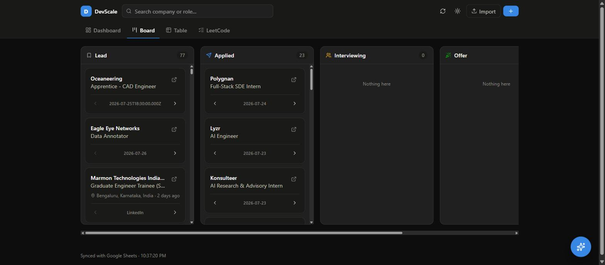

<div align="center">

# 🚀 DevScale — Job Search Command Center

**Track your job search privately, and share leads and contacts with the peers you trust.**

[](https://react.dev/)
[](https://vitejs.dev/)
[](https://tailwindcss.com/)
[](https://supabase.com/)
[](https://groq.com/)
[](https://vercel.com/)

---

[**🔗 Live Demo**](https://devscale-app.vercel.app) &nbsp;•&nbsp; [**📖 Setup Guide**](SETUP.md) &nbsp;•&nbsp; [**🏗️ Architecture**](#-system-architecture) &nbsp;•&nbsp; [**⚡ Key Features**](#-key-features) &nbsp;•&nbsp; [**🔌 API reference**](docs/api.md)

</div>

---

## 📌 Overview

**DevScale** unifies lead tracking, application stages, interview prep (LeetCode), notes and contacts in one responsive web app. It has two workspaces:

- **Personal** — your dashboard, leads, contacts, Kanban board, table, graph, LeetCode plan and notes. Private to you.
- **Team** — leads and contacts you share with **accepted peers**, and the peers themselves. Sharing is opt-in per item, and your application status is never shared.

Everything is stored in **Supabase (Postgres)**. The browser talks to Supabase directly; **all access rules are enforced in the database** (Row Level Security and `SECURITY DEFINER` functions), not in the UI.

---

## 🏗️ System Architecture

```mermaid
flowchart TB
    subgraph Client [" Browser (React 19 SPA on Vercel) "]
        UI["Personal workspace · Team workspace"]
        Auth["Sign up / sign in / reset password"]
    end

    subgraph Supabase [" Supabase "]
        AuthSvc["Auth (email + password, confirmation emails)"]
        API["PostgREST API"]
        DB[("Postgres + Row Level Security")]
        Fn1["Edge Function: ai"]
        Fn2["Edge Function: notify (optional)"]
    end

    Groq["Groq LLM API (Llama 3.3 70B)"]
    Mail["Email provider (SMTP / HTTPS API)"]

    UI -->|anon key + user session| API
    Auth --> AuthSvc
    API --> DB
    UI -->|user session| Fn1
    Fn1 -->|your rows only (RLS)| DB
    Fn1 --> Groq
    AuthSvc -->|confirm / reset| Mail
    DB -->|welcome / sign-in alert triggers| Fn2
    Fn2 --> Mail
```

### Sharing between peers

```mermaid
sequenceDiagram
    autonumber
    actor A as Alice
    actor B as Bob
    participant DB as Postgres (RLS + functions)

    B->>DB: connect_with_peer(Alice's peer code)
    DB-->>A: pending request (list_peers)
    A->>DB: respond_to_request(accept)
    A->>DB: mark a lead "Peer" (plain update on her own row)
    B->>DB: shared_leads_with_me()
    DB-->>B: Alice's peer leads (never her application status)
    B->>DB: import_shared_lead(lead, "applied")
    Note over DB: A new row in Bob's own jobs — Bob's status is independent
    A->>DB: remove_peer / make the lead Personal
    B->>DB: shared_leads_with_me()
    DB-->>B: nothing — access ends immediately; Bob's copy stays his
```

---

## 📸 Screenshots Showcase

<table>
  <tr>
    <td width="50%" align="center">
      <b>📊 Analytics Dashboard</b><br/>
      <i>Pipeline metrics, application velocity, and stage breakdowns</i>
      <br/><br/>
      
    </td>
    <td width="50%" align="center">
      <b>🗂️ Kanban Board View</b><br/>
      <i>Lead → Applied → Interviewing → Offer lifecycle management</i>
      <br/><br/>
      
    </td>
  </tr>
  <tr>
    <td width="50%" align="center">
      <b>📋 Data Table View</b><br/>
      <i>Filterable, sortable, and searchable spreadsheet-style view</i>
      <br/><br/>
      
    </td>
    <td width="50%" align="center">
      <b>✅ LeetCode Prep Tracker</b><br/>
      <i>5-week structured interview prep plan with per-problem progress</i>
      <br/><br/>
      
    </td>
  </tr>
</table>

---

## ✨ Key Features

- 🔐 **Accounts**: sign up with email confirmation, sign in, forgot / reset password, sign out. Wrong-password and unknown-email look identical, and a reset ends every other session.
- 📊 **Executive Dashboard**: pipeline statistics, conversion ratios, applications-over-time and stage charts (Recharts).
- 🗂️ **Kanban board & 📋 table**: Lead → Applied → Interviewing → Offer / Rejected, with search, sorting and inline editing.
- 🧭 **Personal / Team workspaces**: a header switch; each workspace remembers its own last tab.
- 🤝 **Peers**: every account gets a permanent peer code (`PEER-XXXXXX`). Send, accept, reject, cancel and remove connections; wrong-code guesses and request spam are rate-limited.
- 📨 **Lead sharing**: leads are **Personal** (default) or **Peer**. Peers can view a shared lead and **import it as their own copy** — their own status and history. Making it Personal or removing the peer ends access immediately.
- 👥 **Contacts**: name, email, phone, company, designation, LinkedIn, notes. Personal or Peer (peers never see your notes), search, filter, **paste-import** from a spreadsheet, and "save to my contacts".
- 🤖 **AI assistant** *(deploy the `ai` Edge Function — see SETUP)*: Groq (Llama 3.3 70B) answers questions about *your* pipeline and notes, and analyses rejection emails.
- 🗒️ **Notes**, 🕸️ **connections graph**, 💡 **LeetCode planner**, 📥 **smart bulk importer** (jobs and contacts), 📖 **in-app guide**.
- ✉️ **Emails**: confirmation and reset through your SMTP account; optional welcome and new-sign-in emails via the `notify` Edge Function.
- 📱 **Responsive** with 🌗 **light / dark** themes.

---

## 🛠️ Technology Stack

| Layer | Technology | Purpose |
| :--- | :--- | :--- |
| **Frontend** | React 19, Vite 8, Tailwind CSS v4 | SPA, styling, Recharts, Lucide icons |
| **Auth** | Supabase Auth | Email + password, email confirmation, password reset |
| **Database** | Supabase Postgres | Row Level Security on every table; access rules in `SECURITY DEFINER` functions |
| **Edge Functions** | Deno (Supabase) | `ai` (Groq gateway), `notify` (welcome / sign-in emails) |
| **AI** | Groq (Llama 3.3 70B) | Pipeline reasoning and chat |
| **Email** | Your SMTP account; Resend or Brevo web API | Auth emails; welcome / alert emails |
| **Testing** | Vitest + Testing Library, pgTAP, Node end-to-end scripts | See [Testing](#-testing) |
| **Hosting** | Vercel | Static frontend |

---

## ⚡ Quick Start

```bash
git clone https://github.com/Soumyadeep143/DevScale.git
cd DevScale/client
npm install
cp .env.example .env.local   # fill in your Supabase URL and anon key
npm run dev
```

The database, authentication settings, email and the AI function need a Supabase project:

👉 [**Read the Full Setup Guide (SETUP.md)**](SETUP.md)

---

## 🔒 Security Model

- **Access control lives in the database.** Every table has Row Level Security; peers never read another user's rows directly. Shared data is reachable only through functions that re-check the live peer relationship and visibility on every call, so revocation is immediate. The UI hiding a tab is never the protection.
- **The browser holds only the anon key and the user's session.** Owner ids are never accepted from the client — the database derives them from the session.
- **No anonymous access.** The signed-out role has no table privileges, and no function but a Supabase-managed one is executable by it.
- **Abuse limits for open sign-up.** 10 wrong peer codes per hour, 20 new requests per hour, 10 requests waiting at once, a 24-hour wait after being declined, and bounded display names.
- **Server-side secrets.** Groq and email-provider keys are Edge Function secrets, never in the client bundle. The service-role key is only for scripts and scrapers — never put it in a `VITE_*` variable.
- **Email.** Subjects are static and all dynamic values are escaped; recipients come from the auth database, not the request.

---

## 🧪 Testing

```bash
cd client
npm test                 # Vitest: UI, data layer, Edge Function logic, email templates
npm run lint && npm run build
supabase test db         # pgTAP: RLS, sharing, rate limits, privileges (needs Supabase CLI + Docker)

# Live end-to-end checks — create throwaway users and delete them afterwards
SUPABASE_URL=... SUPABASE_ANON_KEY=... SUPABASE_SERVICE_KEY=... node scripts/e2e-sharing.mjs
SUPABASE_URL=... SUPABASE_ANON_KEY=... SUPABASE_SERVICE_KEY=... node scripts/e2e-auth.mjs   # sends no email
```

---

## 📄 License

This project is open-source and shared as a personal job-search management solution. Feel free to fork and adapt it for your personal career tracking!
