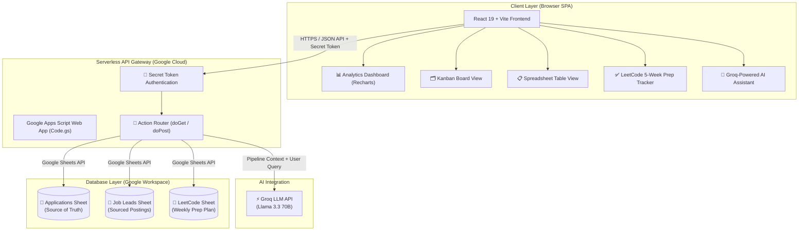
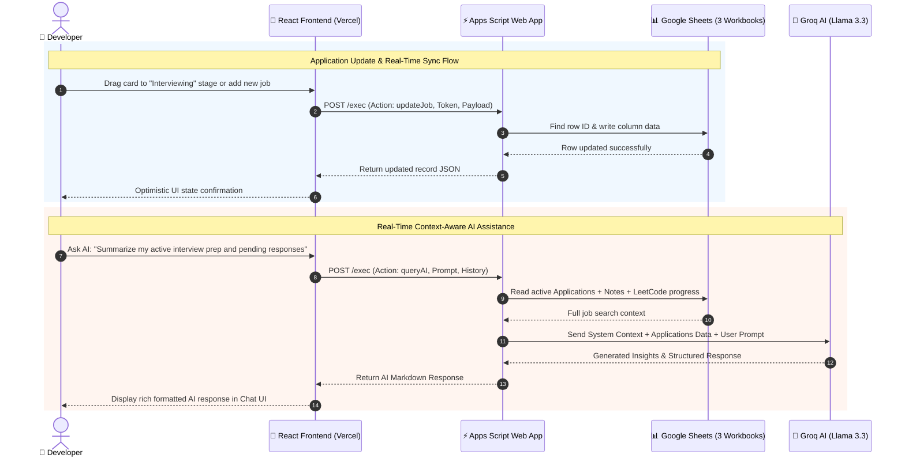
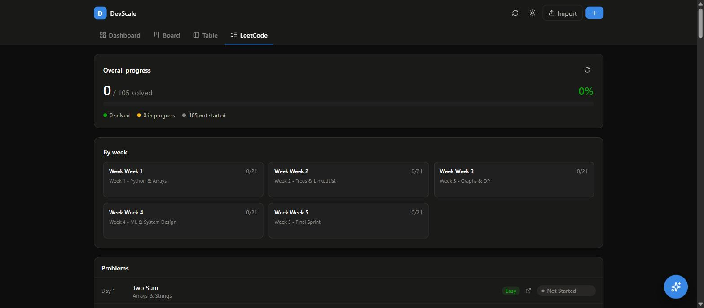

<div align="center">

# 🚀 DevScale — Job Search Command Center

**A full-featured, zero-cost job-search management platform that lives entirely in your Google Sheets — no database, no backend server overhead.**

[](https://react.dev/)
[](https://vitejs.dev/)
[](https://tailwindcss.com/)
[](https://developers.google.com/apps-script)
[](https://groq.com/)
[](https://vercel.com/)

---

[**🔗 Live Demo**](https://devscale-app.vercel.app) &nbsp;•&nbsp; [**📖 Setup Guide**](SETUP.md) &nbsp;•&nbsp; [**🏗️ Architecture**](#-system-architecture) &nbsp;•&nbsp; [**⚡ Key Features**](#-key-features)

</div>

---

## 📌 Overview

**DevScale** transforms plain Google Sheets into an enterprise-grade job search command center. It unifies lead tracking, application lifecycles, interview stages, offer evaluations, and technical interview preparation (LeetCode) into a sleek, responsive web interface.

Instead of paying recurring database fees or setting up complex backend infrastructure, **DevScale uses Google Sheets as a high-reliability, zero-maintenance database** powered by a serverless Google Apps Script API gateway.

---

## 🏗️ System Architecture

### 1. High-Level System Architecture



### 2. Two-Way Synchronization & AI Sequence Flow



---

## 📸 Screenshots Showcase

<table>
  <tr>
    <td width="50%" align="center">
      <b>📊 Analytics Dashboard</b><br/>
      <i>Pipeline metrics, application velocity, and stage breakdowns</i>
      <br/><br/>
      
    </td>
    <td width="50%" align="center">
      <b>🗂️ Kanban Board View</b><br/>
      <i>Lead → Applied → Interviewing → Offer lifecycle management</i>
      <br/><br/>
      
    </td>
  </tr>
  <tr>
    <td width="50%" align="center">
      <b>📋 Data Table View</b><br/>
      <i>Filterable, sortable, and searchable spreadsheet-style view</i>
      <br/><br/>
      
    </td>
    <td width="50%" align="center">
      <b>✅ LeetCode Prep Tracker</b><br/>
      <i>5-week structured interview prep plan synced live to Sheets</i>
      <br/><br/>
      
    </td>
  </tr>
</table>

---

## ✨ Key Features

- 📊 **Executive Dashboard**: Live pipeline statistics, conversion ratios, applications-over-time trend chart, and stage distribution charts powered by Recharts.
- 🗂️ **Kanban Pipeline Board**: Drag-free card-based workflow tracking applications across `Lead`, `Applied`, `Interviewing`, and `Offer` stages.
- 📋 **Spreadsheet Data Table**: Powerful tabular view with multi-field search, status filtering, column sorting, and inline editing.
- 🤖 **Context-Aware AI Assistant**: Native integration with **Groq (Llama 3.3 70B)**. The AI analyzes your entire job search pipeline and notes to answer complex questions (e.g., *"How many jobs have I applied to today?"* or *"Where am I failing, and what's my strategy?"*).
- 🔍 **AI Rejection Analysis**: Paste a rejection email into a job's notes, click Analyze — the AI states the likely reason and one concrete next step, and only saves it to that job's notes if you confirm.
- 🗒️ **Notes**: A standalone strategy log, separate from any one job, backed by Supabase — the AI assistant reads it too.
- 🕸️ **Connections graph**: An interactive, Obsidian-style node graph of how your jobs, companies, stages, and notes relate to each other.
- 💡 **LeetCode Interview Prep Planner**: Built-in 5-week study plan trackable by problem status, difficulty, and topic, synchronized directly with a dedicated Google Sheet.
- 🔄 **Real-Time Synchronization across Website, Sheets, and Supabase**:
  - **App ➔ Sheets**: Edits write back to Google Sheets instantly via API calls.
  - **Sheets ➔ App**: Automatic background polling (10s, backing off under load) + instant refetch on window focus.
  - **App/Sheets ➔ Supabase**: Every write mirrors into a Supabase `jobs` table — a one-way mirror (never written back), so there's no sync-loop risk.
- 📥 **Smart Bulk Importer**: Auto-detects and parses raw spreadsheet copy-pastes into structured records, with an in-app format guide and an explicit format picker if auto-detect guesses wrong.
- 📖 **In-app Guide**: A built-in walkthrough of the whole workflow, reachable from the nav — not just docs in the repo.
- 📱 **Mobile & Desktop Responsive**: Clean UI designed with Tailwind CSS for seamless use on desktop monitors and mobile devices.
- 🌗 **Light / Dark Mode**: Full theme customization to suit your preference.

---

## 🛠️ Technology Stack

| Layer | Technology / Tool | Description & Purpose |
| :--- | :--- | :--- |
| **Frontend Framework** | **React 19** | Ultra-responsive component UI architecture |
| **Build System** | **Vite 8** | Next-generation fast HMR bundler |
| **Styling & Design** | **Tailwind CSS v4** | Modern, utility-first UI styling with responsive design |
| **Data Visualization** | **Recharts** | Interactive charts for pipeline analytics and application trends |
| **Icons** | **Lucide React** | Clean, consistent icon set |
| **API Gateway** | **Google Apps Script** | Serverless `doGet`/`doPost` JSON endpoint hosted on Google Cloud |
| **Database Storage** | **Google Sheets** | 3 relational-style Google Workbooks (Applications, Leads, LeetCode) — the source of truth |
| **Mirror Database** | **Supabase (Postgres)** | One-way mirror of jobs, plus the standalone Notes table — written to, never read from, by the sheet or app |
| **AI LLM Engine** | **Groq (Llama 3.3 70B)** | High-speed inference engine for pipeline reasoning & chat |
| **Hosting & CD** | **Vercel** | Edge-network global deployment for static assets |

---

## 💡 Why DevScale over Traditional SaaS / DBs?

1. **Zero Database Maintenance & Hosting Cost**: No Postgres/MongoDB fees, no connection pools, no server provisioning. Google Workspace provides all storage infrastructure for free.
2. **Complete Data Ownership**: Your job application data, salaries, and interview notes remain strictly inside your private Google Drive.
3. **Dual Interfaces**: Edit your data through DevScale's modern React UI or edit raw cells directly in Google Sheets when working on bulk edits or offline tasks — both interfaces remain synced in real time.
4. **Zero Schema Rewriting**: DevScale maintains your native spreadsheet dropdown options, formulas, and formatting without corrupting raw data.

---

## ⚡ Quick Start & Setup Overview

### 1. Local Development Setup

```bash
# Clone the repository
git clone https://github.com/Soumyadeep143/DevScale.git
cd DevScale/client

# Install frontend dependencies
npm install

# Configure environment variables
cp .env.example .env.local

# Start the Vite development server
npm run dev
```

### 2. Backend & Sheets Setup

For complete, step-by-step instructions on deploying the Google Apps Script Web App, configuring the `GROQ_API_KEY`, and deploying to Vercel, please refer to the comprehensive guide:

👉 [**Read the Full Setup Guide (SETUP.md)**](SETUP.md)

---

## 🔒 Security & Privacy Architecture

- **No Public Database**: All data operations pass strictly through your personal Google Apps Script deployment.
- **Token Security**: API access is protected via a custom `SECRET_TOKEN` header verified before executing any sheet mutation.
- **Client-Side Storage**: Web App URLs and auth tokens are persisted locally in `localStorage` on your client browser.
- **Server-Side AI Keys**: The Groq API key is stored securely within Apps Script `ScriptProperties` on Google servers, never exposed to the client bundle.

---

## 📄 License

This project is open-source and shared as a personal job-search management solution. Feel free to fork and adapt it for your personal career tracking!
