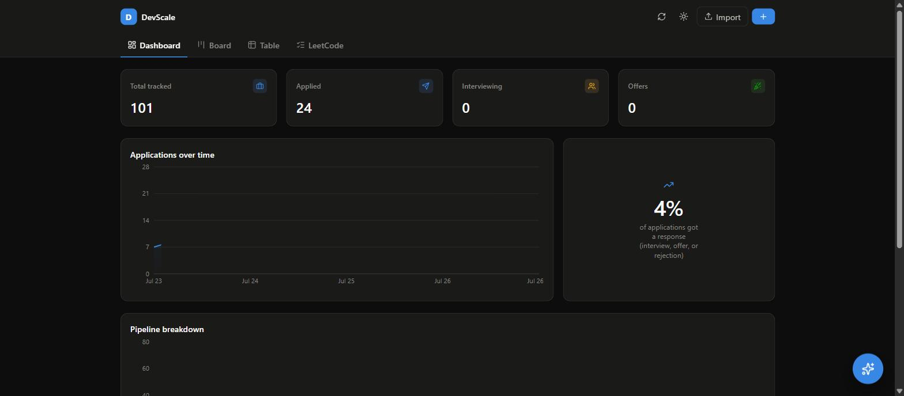
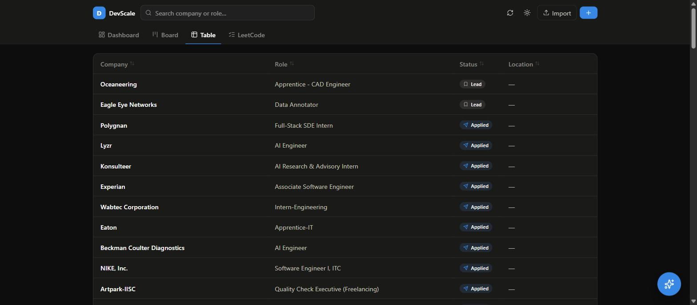

<div align="center">

# DevScale

**A job-search command center that lives entirely in your Google Sheets — no database, no backend to babysit.**

Track leads → applications → interviews → offers on a kanban board or a spreadsheet-style table, get a live dashboard of your pipeline, keep a LeetCode prep tracker in sync, and ask an AI assistant questions about your own search — all backed by the Google Sheets you already have.

[**🔗 Live App**](https://devscale-app.vercel.app) · [Setup Guide](SETUP.md)


</div>

---

## Screenshots

<table>
<tr>
<td width="50%">

**Dashboard** — pipeline stats, application trend, and stage breakdown at a glance



</td>
<td width="50%">

**Board** — drag-free kanban across Lead → Applied → Interviewing → Offer


</td>
</tr>
<tr>
<td width="50%">

**Table** — every application as a sortable, searchable spreadsheet view



</td>
<td width="50%">

**LeetCode Tracker** — a 5-week prep plan synced to its own sheet, with per-problem status


</td>
</tr>
</table>

---

## Why this exists

Manually copying rows between a "jobs I'm applying to" sheet and a "leads I've scraped" sheet gets old fast. DevScale wraps three existing Google Sheets in one app:

- **Tracking sheet** — the source of truth for every application: company, role, status, dates, notes.
- **Leads sheet** — jobs you've found but haven't applied to yet. Mark one "Applied" in the app and it's copied into the tracking sheet automatically, exactly the way the original spreadsheet macro used to.
- **LeetCode sheet** — a weekly interview-prep plan with per-problem status.

Every field keeps the exact format it already has in Sheets — checkboxes stay checkboxes, dropdowns stay dropdowns with their existing option text. The app never silently rewrites your data into some other shape.

## Features

- 📊 **Dashboard** — total tracked, applied/interviewing/offer counts, an applications-over-time trend line, and a pipeline breakdown chart
- 🗂️ **Board view** — kanban columns for Lead, Applied, Interviewing, and Offer
- 📋 **Table view** — sortable, searchable list of every application
- ✅ **LeetCode progress tracker** — weekly breakdown, per-problem status dropdown, synced live to its own sheet
- 🤖 **AI assistant** — multi-turn chat (Groq / Llama 3.3) that can see your full pipeline *and* your notes on each job, so you can ask things like "which companies am I still waiting to hear back from?"
- 🔄 **True two-way sync** — edits in the app write straight to Sheets instantly; edits made by hand in Sheets show up in the app within seconds (polling + refresh-on-focus)
- 📥 **Bulk import** — paste rows copied from an old spreadsheet and it auto-detects the format
- 📱 **Responsive** — built for daily use on both laptop and phone
- 🌗 **Light/dark theme**

## Architecture

```
┌─────────────────┐        HTTPS / JSON        ┌───────────────────────┐
│   React + Vite   │ ─────────────────────────▶ │  Google Apps Script   │
│  (static site,    │ ◀───────────────────────── │   (serverless API)   │
│   Vercel)         │                             └───────────┬───────────┘
└─────────────────┘                                          │
                                                    reads/writes 3 sheets
                                                               │
                                    ┌──────────────────────────┼──────────────────────────┐
                                    ▼                          ▼                          ▼
                          Tracking sheet              Leads sheet                LeetCode sheet
```

There's no database and no traditional backend — a single Google Apps Script Web App (`apps-script/Code.gs`) is the entire API layer, deployed for free on Google's infrastructure, talking directly to three spreadsheets. The React app is a static site that calls that API straight from the browser.

## Tech stack

| Layer | Choice |
|---|---|
| Frontend | React 19, Vite 8, Tailwind CSS v4, Recharts, lucide-react |
| Backend | Google Apps Script (`doGet`/`doPost` as a JSON API) |
| Database | Google Sheets (three spreadsheets, used directly) |
| AI | Groq (Llama 3.3 70B) |
| Hosting | Vercel |

## Running it yourself

This is a personal, single-user tool by design — no login system, the connection details are baked in at build time via environment variables. See **[SETUP.md](SETUP.md)** for the full walkthrough: connecting your own Google Sheets, deploying the Apps Script backend, wiring up the Groq API key, and deploying to Vercel.

```bash
cd client
npm install
cp .env.example .env.local   # fill in your own Apps Script URL + token
npm run dev
```

## Security note

The Apps Script URL and access token are read from `VITE_APPS_SCRIPT_URL` / `VITE_APPS_SCRIPT_TOKEN` environment variables (`.env.local` locally, project settings on Vercel) rather than hardcoded — they're kept out of source control. They do still end up in the built JS bundle, same as any client-only app with no backend proxy; that's an accepted tradeoff for a personal tool with a real access token guarding the API, not a public secret.

## License

Personal project, shared as-is for reference.
